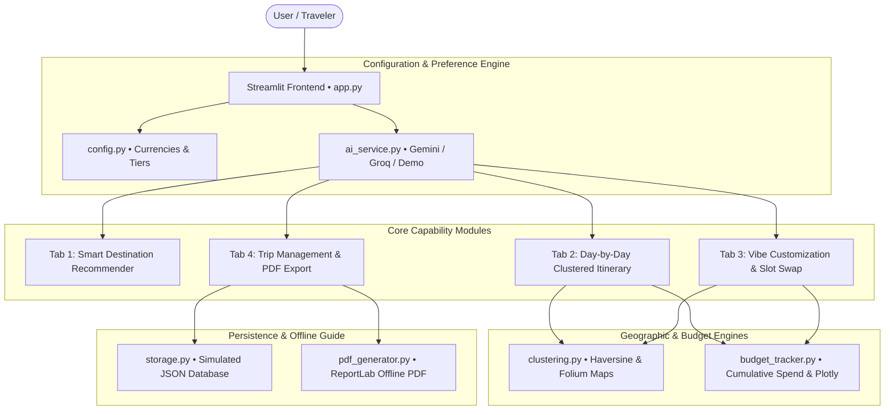

# ✈️ Personalized Travel Itinerary Planner
### *Skill Wallet Capstone Project 4 • Production-Ready Full-Stack Travel SaaS Architecture*

An intelligent, production-grade travel planning SaaS built with **Streamlit, Google Gemini / Groq LLMs, Leaflet/Folium, Plotly, and ReportLab**. 

Engineered with **zero external database dependencies** for seamless **1-click deployment on Streamlit Community Cloud**, featuring geographic clustering to eliminate transit fatigue, dynamic single-slot activity swapping, live dual-currency budget tracking, and publication-ready offline PDF guide export with emergency directories.

---

## 🌟 Key Highlights & Architectural Modules

### 1. ⚙️ Configuration & User Preferences (Epic 3)
- **Flexible Engine Modes**:
  - **Demo Mode (Zero Setup)**: High-fidelity realistic generator enabled out-of-the-box with pre-calculated GPS coordinates, districts, and realistic pricing.
  - **Google Gemini**: Integrated via `google-genai` SDK (`gemini-2.5-flash`).
  - **Groq Cloud**: Integrated via `groq` SDK for sub-second inference (`llama-3.3-70b-versatile`).
- **Comprehensive Trip Intake**:
  - Open-ended destination input or mood-based discovery.
  - **Vibe / Mood Taxonomy**: Beach & Coastal, Mountains & Trekking, Cultural Discovery, Urban Skyline, Romantic, Culinary, Wellness, and Adrenaline.
  - Duration (1–10 Days), Dynamic Date Range Picker.
  - **Budget Tiers**: Budget ($65/day benchmark), Moderate ($180/day), Luxury ($450/day).
  - **Currency Engine**: Live dual conversions across USD ($), INR (₹), EUR (€), GBP (£), JPY (¥), AUD (A$), and CAD (C$).
  - **Travel Party & Pace**: Solo, Couple, Family with Kids, Friends; Relaxed, Moderate, Fast-Paced.
  - **Interests & Dietary**: Multi-select interests + Vegetarian, Vegan, Halal, Kosher, Gluten-Free, Jain selections.

### 2. 🧭 Tab 1 - Smart Destination Recommender (Epic 3)
- Real-time recommendation engine suggesting the **top 3 matching destinations** based on travel mood, budget tier, and party profile.
- Displays match scores (e.g. `96% Match`), optimal weather season, average daily spend, customized "Why this matches you" rationale, signature highlights, and top neighborhoods.
- **1-Click Handoff**: `✈️ Select [City] & Build Itinerary` button directly triggers the multi-day itinerary generator without manual re-entry.

### 3. 📅 Tab 2 - Day-by-Day Optimized Itinerary Generator (Epic 4)
- **Structured Sequential Slots**:
  - 🌅 **Morning Sightseeing** (09:00 – 12:30)
  - 🍽️ **Lunch Recommendation** (12:30 – 14:00) with local cuisine specialty & dietary options
  - 🏛️ **Afternoon Leisure & Culture** (14:30 – 17:30)
  - 🌙 **Evening Dining & Entertainment** (18:30 – 22:00)
- **Geographic Clustering Logic**:
  - Automatically anchors all 4 activities of each day within a localized district/neighborhood (e.g. *7th Arrondissement & Eiffel Precinct*, *Shibuya & Harajuku*).
  - Explicit transit guidance between sequential slots (e.g., `🚶 8 min walk via Rue Cler`, `🚇 5 min direct via Ginza Line`).
  - **Transit Fatigue Score**: Computes Haversine great-circle distances across consecutive slots to assign *Low (<3.5 km)*, *Moderate*, or *Elevated* fatigue badges.
  - **Interactive Leaflet/Folium Map**: Markers color-coded by day with dashed route lines visualizing the daily linear path.
- **Cumulative Budget Tracker & Analytics**:
  - Slot-by-slot estimated costs in USD and local target currency (e.g. INR ₹).
  - Plotly dual-axis chart: Daily Spend bars + Running Cumulative Spend progression line.
  - Plotly category spending donut chart (Sightseeing, Food, Culture, Entertainment).
  - Target benchmark comparison with live health status (*Under Budget*, *On Track*, *Over Benchmark*).

### 4. ⚡ Tab 3 - Vibe Customization & Dynamic Activity Swap (Epic 4)
- Dynamic modification of specific time slots **without wiping or regenerating the rest of the multi-day plan**.
- **Preserves Geographic Clustering**: The replacement activity remains strictly anchored within the same day's neighborhood.
- Preset 1-click swaps (e.g., *Outdoor Market & Parks*, *Authentic Vegetarian Dining*, *Free / Budget-Friendly Hidden Gem*, *Romantic Sunset Viewpoint*) or custom prompt input.
- Automatically recalculates itemized daily totals and the running cumulative budget.
- Visual `⚡ Customized Slot` indicator on modified activities.

### 5. 📂 Tab 4 - Trip Management & Offline PDF Export (Epic 5)
- **Zero-Dependency Persistence Database**:
  - Pure Python JSON file storage (`data/trips.json`) that survives server reloads.
  - Browse saved trip history cards, load any previous trip into the active workspace, or delete trips.
- **1-Click Offline PDF Travel Guide**:
  - Built with `reportlab` utilizing a custom palette, typography, headers, and dynamic page numbering (*Page X of Y*).
  - Complete day-by-day sequential breakdown with transit tips, dietary tags, and activity costs.
  - **Offline Safety & Emergency Contacts Directory**: Country-specific emergency hotlines (Police, Ambulance, Fire, General Emergency) and embassy contacts.
  - Travel survival checklist (Passport copies, Travel insurance, Offline maps, Emergency cash, ICE contacts).

---

## 🏗️ System Architecture



---

## 📁 Repository Structure

```
travel_itinerary_planner/
├── app.py                 # Streamlit SaaS application entry point & UI orchestrator
├── config.py              # Configuration constants, currencies, exchange rates, emergency data
├── models.py              # Pydantic data schemas (TripPreferences, ActivitySlot, DayPlan, Itinerary, SavedTrip)
├── ai_service.py          # Unified AI service for Gemini (google-genai) & Groq with fallback
├── mock_data.py           # Rich curated offline data & fallback generators for Demo Mode
├── clustering.py          # Haversine distance calculations, fatigue scoring, Folium Leaflet maps
├── budget_tracker.py      # Dual-currency conversion, cumulative budget ledger, Plotly graphs
├── pdf_generator.py       # Publication-ready ReportLab offline PDF guide with emergency checklist
├── storage.py             # Simulated JSON database persistence with CRUD operations
├── test_suite.py          # End-to-end automated validation script covering all modules
├── requirements.txt       # Python dependencies for local & Streamlit Cloud deployment
├── static/
│   └── styles.css         # Wanderlust-inspired modern travel styling
├── .streamlit/
│   └── config.toml        # Streamlit theme configuration (warm sand & terracotta palette)
└── data/
    └── trips.json         # Local persistent trip records
```

---

## 🚀 Quickstart & Local Installation

### Prerequisites
- Python 3.10+ (Tested up to Python 3.14)
- Pip

### 1. Clone & Enter Directory
```bash
cd /Users/kuldeepsahu/.gemini/antigravity/scratch/travel_itinerary_planner
```

### 2. Install Dependencies
```bash
pip install -r requirements.txt
```

### 3. Run the Automated Test Suite
```bash
python3 test_suite.py
```
*(Verifies that all 6 modules, Leaflet map generation, budget tracking, persistence, and PDF creation pass with 100% success).*

### 4. Launch the Streamlit SaaS Application
```bash
streamlit run app.py
```
Navigate to `http://localhost:8501` in your browser.

---

## ☁️ 1-Click Streamlit Community Cloud Deployment

1. Push this folder to a GitHub repository.
2. Visit [share.streamlit.io](https://share.streamlit.io/) and select your repository.
3. Set **Main file path** to `app.py`.
4. (Optional) In the Streamlit Cloud **Advanced Settings > Secrets**, configure:
   ```toml
   GEMINI_API_KEY = "your-google-gemini-key"
   GROQ_API_KEY = "your-groq-key"
   ```
5. Click **Deploy!** The app runs out of the box with zero external database setup required.
